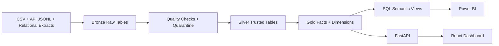

# Enterprise Lakehouse & Data Warehouse

Senior data engineering portfolio project using Databricks-style medallion architecture, PySpark, Spark SQL, Delta Lake design patterns, AWS S3 deployment mapping, FastAPI, React and Docker.

## What This Builds

This platform ingests synthetic enterprise SaaS data from CSV, API-style JSONL and relational-style entities, then transforms it into trusted analytics datasets:

- Bronze: immutable raw ingested records with metadata.
- Silver: cleansed, typed, deduplicated and quality-checked tables.
- Gold: facts, dimensions, star-schema marts and BI-ready analytical datasets.
- Serving: FastAPI analytics endpoints, React dashboard and SQL views for Power BI.

## Architecture



## Technology Stack

| Layer | Technology |
| --- | --- |
| Ingestion | Python, generated CSV and JSONL |
| Processing | Apache Spark, PySpark |
| Lakehouse | Delta Lake design, local Parquet profile, Databricks-ready entrypoint |
| Storage | Local filesystem for demo, AWS S3 mapping documented |
| Modeling | Facts, dimensions, customer 360 mart, revenue daily mart |
| Serving | FastAPI, DuckDB, SQL views |
| Frontend | React, Vite, Recharts |
| Deployment | Docker, Docker Compose |

## Quick Start

```bash
pip install -r requirements.txt
python scripts/generate_data.py --scale 2 --output data/raw
python pipelines/lakehouse_pipeline.py --raw data/raw --lake data/lakehouse --warehouse data/warehouse
uvicorn backend.app.main:app --reload --port 8000
```

In a second terminal:

```bash
cd frontend
npm install
npm run dev
```

Open the dashboard at `http://localhost:5173` and the API at `http://localhost:8000/docs`.

## Docker

Generate data and run the pipeline first so the containers have curated warehouse files:

```bash
python scripts/generate_data.py --scale 2 --output data/raw
python pipelines/lakehouse_pipeline.py --raw data/raw --lake data/lakehouse --warehouse data/warehouse
docker compose up --build
```

Then open:

- Frontend: `http://localhost:5173`
- API: `http://localhost:8000/docs`

## Dataset

The generator creates deterministic SaaS data with a fixed seed:

- `customers.csv`
- `products.csv`
- `transactions.csv`
- `support_events.csv`
- `web_events.jsonl`

It intentionally injects duplicate and invalid records so the pipeline demonstrates senior-level data quality handling, deduplication and quarantine flows.

## Gold Model

| Table | Purpose |
| --- | --- |
| `dim_customer` | Customer attributes for segmentation and geography |
| `dim_product` | Product and category attributes |
| `fact_revenue` | Transaction-level revenue facts |
| `fact_support` | Ticket and customer experience facts |
| `fact_engagement` | Web behavior events |
| `mart_customer_360` | BI-ready customer health and lifetime value mart |
| `mart_revenue_daily` | Daily category revenue mart |

## Incremental and Quality Strategy

Each Silver table uses a business key and `updated_at` watermark to retain the latest source version. Invalid records are written to `data/lakehouse/quarantine/<dataset>` for audit and remediation. Pipeline metrics are stored in `data/lakehouse/_metadata/run_metrics.json`.

## Benchmarking

The pipeline records runtime and row counts for each layer. Increase `--scale` in `scripts/generate_data.py` to benchmark larger runs:

```bash
python scripts/generate_data.py --scale 10 --output data/raw
python pipelines/lakehouse_pipeline.py
```

Example benchmark fields:

- total runtime seconds
- Bronze rows
- Silver rows
- rejected rows
- Gold rows

## Databricks, Delta Lake and AWS S3

The local profile writes Parquet so the project can run anywhere. In Databricks, the same medallion table boundaries should be backed by Delta Lake tables on S3 for ACID transactions, schema enforcement, merge/upsert operations and time travel.

See:

- `docs/databricks_aws.md`
- `docs/architecture.md`
- `docs/lineage.md`

## Power BI

Use `sql/gold_semantic_layer.sql` to create BI-facing views in Databricks SQL. Power BI can connect to those views using the Databricks connector, or consume the FastAPI endpoints for a lightweight demo.

## Repository Structure

```text
backend/                 FastAPI analytics service
frontend/                React dashboard
pipelines/               PySpark medallion pipeline
scripts/                 Synthetic data generator
sql/                     BI semantic SQL views
docs/                    Architecture, lineage and deployment notes
data/                    Generated local data and warehouse outputs
docker-compose.yml       Full-stack local deployment
```

## Senior-Level Evidence

This project demonstrates:

- architectural tradeoffs and cloud deployment mapping
- reproducible synthetic data generation
- distributed transformations with Spark
- medallion lakehouse modeling
- incremental keys and watermarks
- deduplication and data quality quarantine
- dimensional modeling and BI serving
- API and dashboard productization
- documented access controls, lineage and design decisions
