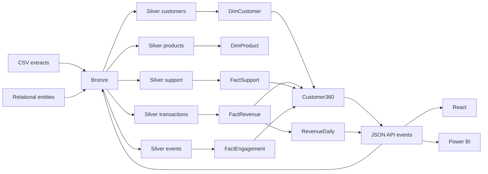

# Lineage

## Data Quality Rules

| Dataset | Business Key | Watermark | Quality Rules |
| --- | --- | --- | --- |
| customers | `customer_id` | `updated_at` | valid customer id and email |
| products | `product_id` | `updated_at` | non-negative price |
| transactions | `transaction_id` | `updated_at` | non-empty transaction id, positive quantity |
| support_events | `ticket_id` | `updated_at` | ticket and customer present |
| web_events | `event_id` | `updated_at` | event and customer present |

Rejected records are written to `data/lakehouse/quarantine/<dataset>`.
